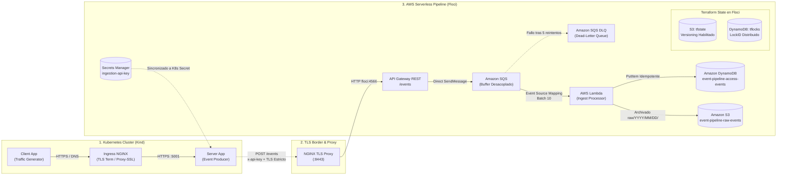

# Cloud-Native Event Pipeline

[](LICENSE)
[](https://kubernetes.io/)
[](https://www.terraform.io/)
[](https://aws.amazon.com/)
[](https://floci.io/)
[](https://python.org/)

Arquitectura *Cloud-Native* completa, modular y de coste cero que integra un clúster local de **Kubernetes (Kind)** con un pipeline de ingesta orientado a eventos y *Serverless* en **AWS**, aprovisionado mediante Infraestructura como Código (**Terraform**) sobre **Floci** (emulador local open-source de AWS).

---

## Arquitectura General



---

## Guía de Lectura y Módulos del Proyecto

Para comprender el diseño y la implementación en profundidad, te recomendamos seguir este recorrido estructurado:

```
  ┌────────────────────────────────────────────────────────┐
  │ 1. PRIMERO: Comprender Kubernetes y Generación Eventos │ ──▶  k8s/README.md
  └────────────────────────────────────────────────────────┘
                              │
                              ▼
  ┌────────────────────────────────────────────────────────┐
  │ 2. DESPUÉS: Ingesta Serverless e IaC en AWS / Floci    │ ──▶  aws/README.md
  └────────────────────────────────────────────────────────┘
```

### [Paso 1: Kubernetes Stack & Emisión de Eventos ➔](k8s/README.md)
Comienza explorando la documentación de Kubernetes en **[`k8s/README.md`](k8s/README.md)** para entender:
* **Topología del Clúster:** Despliegue de un clúster multinodo local con Kind, mapeo de puertos de Ingress y un Docker Registry local en `localhost:5000`.
* **Resolución DNS Dinámica:** Configuración de reglas `rewrite` en CoreDNS para que `server.example.com` y `server.local` resuelvan al servicio interno sin editar `/etc/hosts`.
* **Microservicios y Seguridad de Red:** 
  * `client-app`: Generación de tráfico periódico interno vía TLS.
  * `server-app`: Servidor web seguro con certificados X.509 multi-dominio SAN y ejecución *rootless*.
* **Emisión de Eventos de Acceso:** Cómo la aplicación servidor captura cada petición entrante (`Domain`, `Client IP`, timestamp) y la dispara asíncronamente en segundo plano como evento JSON hacia el endpoint seguro de ingesta.

### [Paso 2: Pipeline Serverless de AWS e Infraestructura como Código ➔](aws/README.md)
A continuación, revisa la documentación de AWS en **[`aws/README.md`](aws/README.md)** para ver cómo se procesan y almacenan los eventos:
* **Emulador Cloud Local Floci:** Ecosistema completo de AWS corriendo en local sobre Docker sin requerir cuenta, tarjeta ni coste.
* **Backend Remoto de Terraform:** Simulación de un entorno enterprise donde el archivo `terraform.tfstate` se guarda en un bucket **S3 versionado** y se gestionan los bloqueos de concurrencia mediante una tabla **DynamoDB** (`LockID`).
* **Ingesta de Alta Concurrencia Desacoplada:** Integración directa entre API Gateway y Amazon SQS (sin función Lambda en el camino síncrono para minimizar latencias y puntos de congestión).
* **Resiliencia y Tolerancia a Fallos:** Cola Dead-Letter (DLQ) para aislar mensajes fallidos o malformados tras 5 reintentos.
* **Persistencia Idempotente Dual:** Función Lambda en Python 3.12 que calcula un hash determinista `sha256(payload)`, guardando el registro estructurado en DynamoDB y archivando el JSON crudo en S3 bajo particiones por fecha (`raw/YYYY/MM/DD/<id>.json`).
* **Seguridad Estricta:** Autenticación por `x-api-key` gestionada en Secrets Manager y validación TLS real sin flags inseguros (`--cacert` exigido, sin `-k`).

---

## Estructura del Repositorio

```text
cloud-native-event-pipeline/
├── LICENSE                      # Licencia MIT (código abierto)
├── Makefile                     # Orquestador maestro (make up, make down, make clean)
├── README.md                    # Esta guía central de arquitectura
├── .gitignore                   # Exclusión de credenciales, tfstate y datos locales
│
├── k8s/                         # ➔ MÓDULO 1: KUBERNETES & EVENT GENERATION
│   ├── README.md                # Guía técnica detallada de Kubernetes
│   ├── Makefile                 # Automatización de Kind, registro, imágenes y despliegue
│   ├── apps/                    # Código fuente Python y Dockerfiles (client-app, server-app)
│   ├── certs/                   # OpenSSL SAN y certificados TLS privados
│   ├── cluster/                 # Configuración de Kind y CoreDNS ConfigMap
│   └── manifests/               # Manifiestos de Kubernetes (Deployments, Services, Ingress)
│
└── aws/                         # ➔ MÓDULO 2: AWS SERVERLESS PIPELINE & IAC
    ├── README.md                # Guía técnica detallada de AWS y Floci
    ├── Makefile                 # Automatización de Floci, Terraform y NGINX TLS proxy
    ├── certs/                   # Certificados OpenSSL multi-dominio para el proxy TLS
    ├── floci/                   # Docker Compose de Floci y NGINX reverse proxy
    ├── lambda/                  # Procesador de eventos en Python 3.12 (ingest_processor)
    ├── scripts/                 # Bootstrap de backend remoto, dump y build de Lambda
    ├── terraform/               # Módulos IaC: backend.tf, queue, storage, processor, api
    └── docs/                    # Análisis técnico, inspección y troubleshooting
```

---

## Puesta en Marcha Rápida (Quickstart)

### Prerrequisitos
* **Docker** (24+) & **Docker Compose** (v2+)
* **Kind** (v0.20+)
* **kubectl** (v1.28+)
* **Terraform** (v1.5+)
* **AWS CLI** (v2+)
* **Helm** (v3.12+)
* **OpenSSL** y **GNU Make**

---

### Comandos de Ejecución

1. **Levantar el entorno completo (AWS + Kubernetes):**
   ```bash
   make up
   ```
   *Esto iniciará Floci, inicializará el backend remoto de Terraform en S3/DynamoDB, aplicará la infraestructura IaC, levantará el proxy NGINX, construirá el clúster Kind y desplegará las cargas de trabajo.*

2. **Verificar el estado del backend remoto de Terraform:**
   ```bash
   make aws-inspect-backend
   ```
   *Muestra el archivo `infra/terraform.tfstate` en S3 con sus versiones históricas y la tabla de locks en DynamoDB.*

3. **Verificar los microservicios en Kubernetes:**
   ```bash
   make k8s-verify
   ```

4. **Sincronizar la API Key y activar el envío de eventos:**
   ```bash
   ./k8s/manifests/server-app-1.0.0/gen-ingestion-secrets.sh
   kubectl apply -f k8s/manifests/server-app-1.0.0/ingestion-api-key.secret.yaml
   kubectl rollout restart deploy/server -n event-pipeline
   ```

5. **Inspeccionar eventos procesados en AWS (Floci):**
   ```bash
   # Comprobar registros estructurados en DynamoDB
   aws --endpoint-url=http://localhost:4566 dynamodb scan --table-name event-pipeline-access-events

   # Comprobar archivos JSON crudos archivados en S3
   aws --endpoint-url=http://localhost:4566 s3 ls s3://event-pipeline-raw-events --recursive
   ```

6. **Detener o limpiar el entorno:**
   ```bash
   # Parar contenedores y clúster
   make down

   # Limpieza profunda (eliminar volúmenes y estados locales)
   make clean
   ```

---

## Licencia

Este proyecto está distribuido bajo los términos de la licencia **MIT**. Consulta el archivo [LICENSE](LICENSE) para más información.
