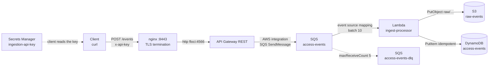

# AWS Serverless Event Ingestion Pipeline — Serverless event-driven ingestion pipeline

Serverless, event-driven ingestion pipeline provisioned as code on **Floci** (a free,
local AWS emulator that exposes every AWS API on `http://localhost:4566`).

```
POST /events (HTTPS, x-api-key)
        │
        ▼
   nginx (TLS)  ──▶  API Gateway REST  ──SendMessage──▶  SQS  ──ESM──▶  Lambda ──▶ DynamoDB + S3
                                                          │                         (idempotent)
                                                     maxReceiveCount 5
                                                          ▼
                                                        SQS DLQ
```

## Tools

Host tooling (versions this project was built and verified with):

```bash
Docker 29.1.5            # runs Floci and the nginx TLS proxy
Docker Compose 5.3.1     # single-command bring-up
Terraform v1.5.7         # IaC (required_version >= 1.5.0)
Python 3.14 (host)       # packages the Lambda ZIP (Lambda RUNTIME is python3.12)
OpenSSL 3.6.1            # self-signed TLS certificate
AWS CLI 2.13.19          # inspection / dumps (--endpoint-url http://localhost:4566)
GNU Make 3.81            # orchestration
```

Pinned in the project (never `:latest`):

```bash
floci/floci:2.0.1        # local AWS emulator (environment constraint)
nginx:1.27-alpine        # TLS reverse proxy
hashicorp/aws 5.100.0    # Terraform AWS provider (constraint ~> 5.0)
python3.12               # Lambda function runtime
```

## Architecture



| Component | Resource | Role |
|---|---|---|
| TLS proxy | nginx (`:8443`) | Terminates TLS with a trusted cert and reverse-proxies to Floci's API Gateway. |
| API Gateway REST | `event-pipeline-ingestion-api` | Receives `POST /events` and calls SQS `SendMessage` directly (no Lambda in the sync path). |
| Main queue | `event-pipeline-access-events` | Decouples ingestion from processing. |
| Dead-letter queue | `event-pipeline-access-events-dlq` | Messages that fail 5 times land here (no infinite retries, no loss). |
| Lambda | `event-pipeline-ingest-processor` | Consumes the queue, validates JSON, persists to S3 + DynamoDB. |
| DynamoDB | `event-pipeline-access-events` | Structured record; `event_id = sha256(payload)` → idempotent. |
| S3 | `event-pipeline-raw-events` | Raw payload archived under `raw/YYYY/MM/DD/<event_id>.json`. |
| Secrets Manager | `event-pipeline/ingestion-api-key` | Holds the API key the client sends in `x-api-key`. |

---

## Terraform Remote State Backend (Floci S3 + DynamoDB Locking)

To simulate production cloud engineering workflows and practice without touching an actual cloud account, Terraform state is stored remotely inside **Floci**:

* **State Storage**: S3 bucket `s3://event-pipeline-tfstate` under `infra/terraform.tfstate`, with **bucket versioning** enabled for auditability and recovery.
* **Concurrency Locking**: DynamoDB table `event-pipeline-tflocks` with HASH key `LockID` (String), preventing simultaneous state mutations.
* **Automatic Bootstrap**: Integrated in `make up`, `make plan` and `make apply` via `./scripts/bootstrap_backend.sh`.
* **Inspection**: Run `make inspect-backend` to view the stored `.tfstate` in S3, its versions, and DynamoDB lock records.

```hcl
# aws/terraform/backend.tf
terraform {
  backend "s3" {
    bucket                      = "event-pipeline-tfstate"
    key                         = "infra/terraform.tfstate"
    region                      = "us-east-1"
    endpoint                    = "http://localhost:4566"
    dynamodb_table              = "event-pipeline-tflocks"
    dynamodb_endpoint           = "http://localhost:4566"
    access_key                  = "test"
    secret_key                  = "test"
    skip_credentials_validation = true
    skip_metadata_api_check     = true
    skip_requesting_account_id  = true
    use_path_style              = true
    encrypt                     = true
  }
}
```

## Repository layout

```
.
├── dump-cloud/              # final state dumps (generated manually, see end of file)
├── floci/
│   ├── docker-compose.yaml     # floci + nginx TLS proxy
│   ├── nginx/
│   │   └── default.conf.template
│   └── data/                   # Floci persisted state (gitignored)
├── certs/
│   ├── san.cnf
│   └── nginx/
│       ├── server.pem
│       └── server-key.pem
├── lambda/
│   └── ingest_processor/
│       ├── handler.py
│       └── requirements.txt
├── scripts/
│   ├── build_lambda.sh
│   └── dump_resources.sh
├── terraform/
│   ├── main.tf providers.tf variables.tf outputs.tf versions.tf
│   └── modules/{queue,storage,processor,ingestion_api}/
└── Makefile
```

---

## 1. Floci local cloud (`floci`)

Floci runs Lambda in real Docker containers, so the Docker socket must be mounted. State
is persisted to `./data` (bind mount) with `FLOCI_STORAGE_MODE: hybrid`.

```yaml
# floci/docker-compose.yaml
services:
  floci:
    image: floci/floci:2.0.1          # pinned version, never :latest
    ports:
      - "4566:4566"
    volumes:
      - /var/run/docker.sock:/var/run/docker.sock
      - ./data:/app/data
    environment:
      FLOCI_STORAGE_MODE: hybrid
```

Note: the image is pinned to `2.0.1` (local constraint) and no AWS account,
credit card, or token is required.

---

## 2. Certificates (`certs`)

The endpoint must be served over HTTPS with a **trusted** certificate — the client must
call it **without disabling validation** (`--cacert`, never `-k`).

### OpenSSL config

```ini
# certs/san.cnf  (relevant part)
[ v3_ca ]
subjectAltName      = @alt_names
basicConstraints    = critical, CA:TRUE
keyUsage            = critical, digitalSignature, keyEncipherment, keyCertSign
extendedKeyUsage    = serverAuth, clientAuth

[ alt_names ]
DNS.1               = localhost
IP.1                = 127.0.0.1
```

### Generate the self-signed certificate

```bash
mkdir -p certs/nginx
openssl req -x509 -nodes -days 365 -newkey rsa:2048 \
  -keyout certs/nginx/server-key.pem \
  -out    certs/nginx/server.pem \
  -config certs/san.cnf
```

### Verify the SAN (this is what makes validation pass)

```bash
openssl x509 -in certs/nginx/server.pem -noout -ext subjectAltName
# X509v3 Subject Alternative Name:
#     DNS:localhost, IP Address:127.0.0.1
```

Note: `--cacert server.pem` means "trust this CA", which is real validation — not the
same as `-k`, which disables it. The `subjectAltName` is mandatory: modern clients ignore
the `CN` and only match the SAN.

---

## 3. TLS reverse proxy (nginx)

nginx terminates TLS and reverse-proxies to Floci's API Gateway invoke path over the
internal compose network (`floci:4566`). The dynamic REST API id is injected at container
start via the official image's `envsubst` entrypoint.

```nginx
# floci/nginx/default.conf.template
server {
    listen 443 ssl;
    server_name localhost;

    ssl_certificate     /etc/nginx/certs/server.pem;
    ssl_certificate_key /etc/nginx/certs/server-key.pem;

    location = /events {
        proxy_pass http://floci:4566/restapis/${REST_API_ID}/local/_user_request_/events;
        proxy_set_header Host              $host;
        proxy_set_header X-Forwarded-For   $remote_addr;
        proxy_set_header X-Forwarded-Proto https;
    }
}
```

The proxy is added to the same compose project so it shares Floci's network:

```yaml
# floci/docker-compose.yaml  (nginx service)
  nginx:
    image: nginx:1.27-alpine
    depends_on:
      - floci
    ports:
      - "8443:443"                 # host 443 is used by the k8s kind cluster
    environment:
      REST_API_ID: ${REST_API_ID:-}
    volumes:
      - ./nginx/default.conf.template:/etc/nginx/templates/default.conf.template:ro
      - ../certs/nginx:/etc/nginx/certs:ro
```

Note: nginx's own runtime variables (`$host`, `$remote_addr`, …) are preserved — the
official image only substitutes variables that exist in the environment.

---

## 4. Infrastructure as Code (`terraform`)

The provider points at Floci with dummy credentials and every service endpoint on
`http://localhost:4566` (see `terraform/providers.tf`). The root module composes four
focused child modules, each with **its own least-privilege IAM role** (no `Action:"*"` /
`Resource:"*"`):

```
terraform/modules/
├── queue/          # SQS main queue + DLQ (redrive maxReceiveCount 5)
├── storage/        # DynamoDB table + S3 bucket (versioned, public access blocked)
├── processor/      # Lambda + event source mapping + scoped IAM role
└── ingestion_api/  # API Gateway (direct SQS integration) + API key + Secrets Manager
```

Note: the API key is generated with `random_password`, stored in Secrets Manager, and
attached to the usage plan out-of-band via the AWS CLI (`null_resource`) because the
`aws_api_gateway_api_key` resource crashes the provider against Floci (see
`TROUBLESHOOTING.md`). Nothing sensitive is hardcoded.

---

## 5. Lambda packaging (`scripts/build_lambda.sh`)

Floci does not implement Lambda Layers, so dependencies are bundled into the ZIP.
Compiled bytecode is stripped so the ZIP (and its `source_code_hash`) stays reproducible.

```bash
./scripts/build_lambda.sh
# installs requirements + handler into .build/, removes __pycache__/*.pyc, zips it
```

The handler validates the JSON body and persists **S3 first** (idempotent by key), then a
**conditional PutItem** to DynamoDB (`attribute_not_exists(event_id)`), so a redelivered
SQS message never duplicates and the raw copy is always archived.

---

## 6. Bring it all up with one command

```bash
make up
```

`make up` orchestrates the whole flow (idempotent):

1. `docker compose up -d floci` and wait until healthy.
2. `scripts/build_lambda.sh` — package the Lambda ZIP.
3. `terraform init && terraform apply` — provision everything.
4. `make proxy` — read `terraform output rest_api_id`, write it into
   `floci/.env`, and start nginx bound to that id.

Other targets:

```bash
make plan      # terraform plan
make apply     # terraform apply only
make proxy     # (re)inject rest_api_id and (re)start nginx
make logs      # tail Floci container logs (reliable Lambda output)
make dump      # read-only dump of every resource (see dump_resources.sh)
make down      # docker compose down
make clean     # down + wipe Floci data/ and tfstate together (avoids drift)
make destroy   # terraform destroy
```

Note: on a clean rebuild the REST API id changes; `make up`/`make proxy` re-inject it
automatically, so no file needs manual editing. If you only `restart` Floci the id is
preserved.

---

## 7. Test the pipeline

```bash
export AWS_ACCESS_KEY_ID=test AWS_SECRET_ACCESS_KEY=test AWS_DEFAULT_REGION=us-east-1
E=http://localhost:4566
awslocal() { aws --endpoint-url="$E" "$@"; }

# API key from Secrets Manager (a real client fetches it at runtime)
KEY=$(awslocal secretsmanager get-secret-value \
        --secret-id event-pipeline/ingestion-api-key --query SecretString --output text)
```

### Happy path (HTTPS, validated certificate)

```bash
curl --cacert certs/nginx/server.pem https://localhost:8443/events \
  -H "x-api-key: $KEY" -H "Content-Type: application/json" \
  -d '{"event_id":"evt-1","user":"alice","action":"turnstile_in","ts":"2026-09-09T22:00:00Z"}'
# {"status": "accepted"}  HTTP 200
```

### Idempotency (same payload twice → one record)

```bash
P='{"event_id":"dup","user":"z","action":"scan"}'
curl -s -o /dev/null --cacert certs/nginx/server.pem https://localhost:8443/events -H "x-api-key: $KEY" -H "Content-Type: application/json" -d "$P"
curl -s -o /dev/null --cacert certs/nginx/server.pem https://localhost:8443/events -H "x-api-key: $KEY" -H "Content-Type: application/json" -d "$P"
sleep 6
awslocal dynamodb scan --table-name event-pipeline-access-events --select COUNT   # count does not double
```

### Error path → DLQ

```bash
awslocal sqs send-message \
  --queue-url "$E/000000000000/event-pipeline-access-events" \
  --message-body 'not-json'
# after ~5 retries × 30s visibility it lands in the DLQ:
awslocal sqs get-queue-attributes \
  --queue-url "$E/000000000000/event-pipeline-access-events-dlq" \
  --attribute-names ApproximateNumberOfMessages
```

Note: **Floci community does not validate the API key** — a `POST` without `x-api-key`
still returns `200`. In real AWS it would be `403` (`api_key_required = true` and the
usage plan are configured). This is an emulator limitation, not a design one.

---

## Design decisions / trade-offs

- **Direct API Gateway → SQS integration** (no ingestion Lambda in the sync path): simpler
  and cheaper. The design is flexible; a proxy Lambda would be the alternative
  if pre-enqueue transformation were needed.
- **`event_id = sha256(raw payload)`**: guarantees idempotency on SQS redelivery. It
  dedupes identical payloads, not logical event ids.
- **nginx on `:8443`**: host `:443` is taken by the Kubernetes kind cluster.
- **`timestamp()` forces an API Gateway redeploy every apply**: a Floci fidelity
  workaround (`GetIntegration` returns NotFound on refresh); unnecessary in real AWS.

## End-to-End Integration

- [ ] Remote Terraform state in S3 + DynamoDB lock table.
- [ ] Step Functions orchestration (Retry/Catch) instead of direct SQS→Lambda.
- [ ] ACM certificate declared in Terraform (control plane only on Floci).
- [x] Wire the Kubernetes `server.py` to ship access logs to this endpoint.

### End-to-End Integration 4 — ship Kubernetes access logs to this pipeline

The frontend `server.py` from the Kubernetes cluster now emits every access
(`Domain: <host>, Client IP: <ip>`) as a JSON event and ships it to this
ingestion endpoint. The response to the client is unchanged; shipping is
asynchronous and best-effort, so an ingestion outage never affects the frontend.

```
k8s server pod ──POST /events (x-api-key, TLS validated)──▶ https://host.docker.internal:8443/events
                                                                        │
                                                            nginx → API Gateway → SQS → Lambda
                                                                        ▼
                                                               DynamoDB + S3
```

**What changed in the Kubernetes repo** (`k8s/`):

- `4.-apps/server-app-1.0.0/server.py` — on each `GET /` it fires a background,
  best-effort `POST` of `{domain, client_ip, ts}`. The original is kept as
  `server.original.py` for reference. Everything is env-driven:
  `INGEST_URL`, `INGEST_API_KEY`, `INGEST_CA_PATH`, `INGEST_ENABLED`.
- `k8s/manifests/server-app-1.0.0/deployment.yaml` — adds the `INGEST_*`
  env, mounts the endpoint CA, and pins `host.docker.internal` via `hostAlias`.
  Both ingestion Secrets are `optional: true`, so the pod starts even if this
  AWS stack is not up yet (shipping simply stays off until the Secrets exist).
- `gen-ingestion-secrets.sh` — materialises two Secrets: the API key (read from
  **Secrets Manager**, gitignored) and the endpoint CA (public, committed).

**Secrets — the API key never leaves Secrets Manager as a hardcoded value:**

```bash
# reads event-pipeline/ingestion-api-key and writes the two secret manifests
./k8s/manifests/server-app-1.0.0/gen-ingestion-secrets.sh
kubectl apply -f k8s/manifests/server-app-1.0.0/ingestion-ca.secret.yaml
kubectl apply -f k8s/manifests/server-app-1.0.0/ingestion-api-key.secret.yaml
```

**Networking + TLS.** From inside a pod `localhost` is the pod itself, so the
event is sent to `host.docker.internal` (the host, where nginx listens on
`:8443`). Pods don't inherit the kind node's `/etc/hosts`, so a `hostAlias`
pins `host.docker.internal` to the Docker Desktop host gateway. TLS is
**validated** against the endpoint CA (no `-k`), which is why
`host.docker.internal` was added to the certificate SAN (`certs/san.cnf`).

> Trade-off (local test): the `hostAlias` IP (`192.168.65.254`) is the Docker
> Desktop host gateway and can differ across Docker Desktop versions / OSes (on
> Linux you'd use `--add-host=host.docker.internal:host-gateway`). In production
> the endpoint would have a stable DNS/FQDN (or ACM + custom domain) and neither
> the `hostAlias` nor the `host.docker.internal` SAN entry would be needed.

**Demo** (AWS stack up via `make up`, kind cluster up):

```bash
# rebuild the server image (server.py changed) and push to the local registry
cd k8s/apps
docker build -t localhost:5000/server-app:1.0.0 server-app-1.0.0/
docker push localhost:5000/server-app:1.0.0
cd ..
kubectl apply -f k8s/manifests/server-app-1.0.0/deployment.yaml
kubectl rollout restart deploy/server -n event-pipeline

# drive traffic through the ingress
curl --cacert 6.-certificates/server.crt https://server.local/
curl --cacert 6.-certificates/server.crt https://server.example.com/
```

**Evidence** — the access events land in DynamoDB (the event is stored inside
`raw_payload`, so filter with `contains`, not by a top-level `domain` attribute):

```bash
awslocal dynamodb scan --table-name event-pipeline-access-events \
  --filter-expression "contains(raw_payload, :d)" \
  --expression-attribute-values '{":d":{"S":"server.local"}}' \
  --query 'Items[].raw_payload.S' --output text | tr '\t' '\n'
# {"domain": "server.local", "client_ip": "192.168.65.1", "ts": "2026-09-09T22:21:41...+00:00"}
```


## Cleanup

```bash
make clean          # compose down + wipe Floci data/ and tfstate
docker container prune -f   # optional: remove exited Lambda containers
```

---

## Dumps (final-state evidence → `dump-cloud/`)

Run these after `make up` to capture the resulting state and logs for delivery.
Prerequisites:

```bash
export AWS_ACCESS_KEY_ID=test AWS_SECRET_ACCESS_KEY=test AWS_DEFAULT_REGION=us-east-1
E=http://localhost:4566
awslocal() { aws --endpoint-url="$E" "$@"; }
mkdir -p dump-cloud
```

### One-shot dump of every resource

```bash
./scripts/dump_resources.sh > dump-cloud/resources.txt
```

### S3 — archived raw payloads

```bash
awslocal s3 ls s3://event-pipeline-raw-events --recursive \
  > dump-cloud/s3-ls.txt
awslocal s3api list-objects-v2 --bucket event-pipeline-raw-events \
  > dump-cloud/s3-objects.json
```

### DynamoDB — structured records

```bash
awslocal dynamodb scan --table-name event-pipeline-access-events \
  > dump-cloud/dynamodb-scan.json
```

### SQS — main queue and DLQ

```bash
awslocal sqs get-queue-attributes \
  --queue-url "$E/000000000000/event-pipeline-access-events" \
  --attribute-names All > dump-cloud/sqs-main-attrs.json

awslocal sqs get-queue-attributes \
  --queue-url "$E/000000000000/event-pipeline-access-events-dlq" \
  --attribute-names All > dump-cloud/sqs-dlq-attrs.json
```

### Lambda — configuration + event source mapping

```bash
awslocal lambda get-function-configuration \
  --function-name event-pipeline-ingest-processor \
  > dump-cloud/lambda-config.json

awslocal lambda list-event-source-mappings \
  --function-name event-pipeline-ingest-processor \
  > dump-cloud/lambda-esm.json
```

### Terraform state

```bash
( cd terraform && terraform state list ) > dump-cloud/tf-state-list.txt
( cd terraform && terraform show )       > dump-cloud/tf-show.txt
```

### Lambda logs

```bash
# Floci's CloudWatch Logs API often returns empty events, so container logs are reliable:
docker compose -f floci/docker-compose.yaml logs --no-color floci \
  > dump-cloud/lambda-logs.txt
```

### HTTPS request/response used to test the endpoint

```bash
curl -v --cacert certs/nginx/server.pem https://localhost:8443/events \
  -H "x-api-key: $KEY" -H "Content-Type: application/json" \
  -d '{"event_id":"evt-1","user":"alice","action":"turnstile_in"}' \
  > dump-cloud/https-request.txt 2>&1

```
