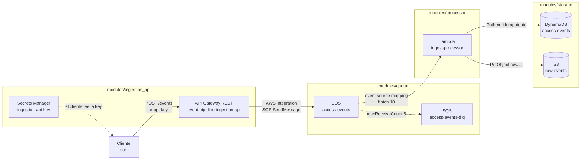

# Arquitectura y pruebas manuales

Pipeline de ingesta de eventos de acceso, desacoplado: la API encola y responde
rápido; el procesado ocurre asíncronamente en la Lambda.

## Diagrama



Versión ASCII (por si el Mermaid no renderiza):

```
 cliente ──POST /events (x-api-key)──▶ API Gateway ──SendMessage──▶ SQS(access-events)
                                                                        │
                                                        event source mapping (batch 10)
                                                                        ▼
                                                                Lambda(ingest-processor)
                                                                   │            │
                                                       PutItem     │            │  PutObject
                                                          ▼        │            ▼
                                                   DynamoDB(access-events)   S3(raw-events)
                                        fallo x5 ─────────┐
                                                          ▼
                                                    SQS(access-events-dlq)

 Secrets Manager(ingestion-api-key)  ← el cliente obtiene aquí la API key
```

## Componentes

| Componente | Recurso | Rol |
|---|---|---|
| API Gateway REST | `event-pipeline-ingestion-api` | Recibe `POST /events` y hace `SendMessage` a SQS (integración directa, sin Lambda en el camino síncrono). |
| Cola principal | `event-pipeline-access-events` | Buffer desacoplado entre ingesta y procesado. |
| DLQ | `event-pipeline-access-events-dlq` | Mensajes que fallan 5 veces (no se pierden ni se reintentan infinito). |
| Lambda | `event-pipeline-ingest-processor` | Consume la cola, valida JSON, persiste en DynamoDB + S3. |
| DynamoDB | `event-pipeline-access-events` | Registro estructurado; `event_id` = sha256(payload) → idempotente. |
| S3 | `event-pipeline-raw-events` | Copia cruda bajo `raw/YYYY/MM/DD/<event_id>.json`. |
| Secrets Manager | `event-pipeline/ingestion-api-key` | Guarda la API key que el cliente manda en `x-api-key`. |

---

## Pruebas manuales

### 0. Levantar y preparar el entorno
```bash
make up          # docker compose up -d + build + terraform apply

export AWS_ACCESS_KEY_ID=test
export AWS_SECRET_ACCESS_KEY=test
export AWS_DEFAULT_REGION=us-east-1
export E=http://localhost:4566
awslocal() { aws --endpoint-url="$E" "$@"; }

# URL de ingesta y API key (desde los outputs / Secrets Manager)
URL=$(cd terraform && terraform output -raw invoke_url)
KEY=$(awslocal secretsmanager get-secret-value \
        --secret-id event-pipeline/ingestion-api-key --query SecretString --output text)
echo "$URL"
```

### 1. Ingesta (happy path)
```bash
curl -s -w "\nHTTP %{http_code}\n" -X POST "$URL" \
  -H "x-api-key: $KEY" -H "Content-Type: application/json" \
  -d '{"event_id":"evt-1","user":"alice","action":"turnstile_in","ts":"2026-09-08T21:00:00Z"}'
```
Esperado: `{"status": "accepted"}` y `HTTP 200`. (El endpoint solo encola; el
procesado es asíncrono, ver paso 3.)

### 2. Ingesta de varios eventos (para tener datos)
```bash
for i in 1 2 3; do
  curl -s -o /dev/null -w "POST $i -> HTTP %{http_code}\n" -X POST "$URL" \
    -H "x-api-key: $KEY" -H "Content-Type: application/json" \
    -d "{\"event_id\":\"evt-$i\",\"user\":\"u$i\",\"action\":\"scan\"}"
done
```

### 3. Ver los datos (consultas)
```bash
# ¿Se vació la cola? (mensaje consumido por la Lambda)
awslocal sqs get-queue-attributes \
  --queue-url "$E/000000000000/event-pipeline-access-events" \
  --attribute-names ApproximateNumberOfMessages

# DynamoDB: todos los items
awslocal dynamodb scan --table-name event-pipeline-access-events

# DynamoDB: solo el número de items
awslocal dynamodb scan --table-name event-pipeline-access-events --select COUNT

# S3: objetos crudos archivados
awslocal s3api list-objects-v2 --bucket event-pipeline-raw-events \
  --query "Contents[].Key"

# S3: contenido de un objeto concreto
awslocal s3 cp "s3://event-pipeline-raw-events/<key-de-arriba>" -
```

### 4. Idempotencia (no duplica)
```bash
P='{"event_id":"dup","user":"z","action":"scan"}'
curl -s -o /dev/null -w "1 -> %{http_code}\n" -X POST "$URL" -H "x-api-key: $KEY" -H "Content-Type: application/json" -d "$P"
curl -s -o /dev/null -w "2 -> %{http_code}\n" -X POST "$URL" -H "x-api-key: $KEY" -H "Content-Type: application/json" -d "$P"
sleep 6
# El count NO sube por el segundo envío: mismo payload -> mismo event_id (sha256) -> put condicional
awslocal dynamodb scan --table-name event-pipeline-access-events --select COUNT
```

### 5. Camino de error → DLQ (opcional)
Enviar un mensaje **no-JSON** directamente a la cola (saltando la API) fuerza el
fallo del handler; tras 5 reintentos aterriza en la DLQ:
```bash
awslocal sqs send-message \
  --queue-url "$E/000000000000/event-pipeline-access-events" \
  --message-body 'esto-no-es-json'

# Tras ~2-3 min (5 reintentos × visibility 30s) aparece en la DLQ:
awslocal sqs get-queue-attributes \
  --queue-url "$E/000000000000/event-pipeline-access-events-dlq" \
  --attribute-names ApproximateNumberOfMessages
```

### 6. Logs de la Lambda
```bash
make logs        # sigue los logs del contenedor Floci (salida real de la Lambda)
```
O invócala directamente con un evento SQS sintético para ver el error de forma
síncrona (devuelve `FunctionError` si el handler lanza excepción):
```bash
awslocal lambda invoke --function-name event-pipeline-ingest-processor \
  --cli-binary-format raw-in-base64-out \
  --payload '{"Records":[{"messageId":"m1","body":"{\"event_id\":\"probe\",\"user\":\"x\"}"}]}' \
  /tmp/out.json && cat /tmp/out.json
```
> La API de CloudWatch Logs de Floci suele devolver eventos vacíos; por eso `make logs`
> (que lee `docker compose logs`) es la vía fiable.

### Volcado completo de una vez
```bash
make dump        # vuelca TODOS los recursos y sus datos (ver INSPECTION.md)
```

---

## ⚠️ Notas de Floci (importantes para las pruebas)

- **La API key NO se valida en Floci community.** `POST` sin `x-api-key` o con una key
  inválida igualmente devuelve `200 {"status":"accepted"}`. En AWS real daría `403
  Forbidden` (el `api_key_required = true` y el usage plan sí están configurados). Es una
  limitación del emulador, no del diseño.
- **Endpoint interno de la Lambda:** la función usa `http://localhost.localstack.cloud:4566`
  (no `localhost:4566`) para poder alcanzar Floci desde su contenedor.
- **Re-`apply` de API Gateway:** re-aplicar sobre un stack ya levantado puede dar `500
  "No integration configured"` intermitente por la baja fidelidad de lectura de Floci; un
  `make up` limpio siempre funciona. (Detalle en `TROUBLESHOOTING.md`.)
